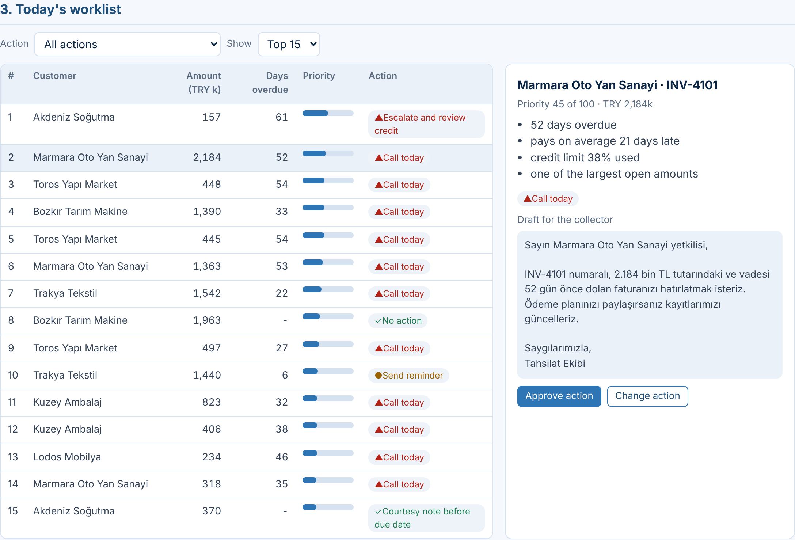

### Hi, I'm Alihan 👋

**Enterprise AI consultant and transformation leader** — I help leadership teams turn AI from pilots into governed, measurable decision systems.

- 📡 **Telecom AI & AIOps** — operational intelligence, network and customer-experience analytics
- 🏦 **Financial services data** — KYC, data quality and compliance-ready data platforms
- 🧭 **C-level advisory** — AI strategy, operating models and board-level business cases; presented to the Board at stc
- 🌍 Worked across Türkiye, Germany, the USA and Saudi Arabia · based in Istanbul
- 🎓 Data Science, Columbia Engineering · Electrical & Electronics Engineering · Executive MBA
- ✍️ Writing a book on the architecture, economics and governance of autonomous enterprise decision systems

### Featured: Receivables agent

**Which invoices should your collections team chase today, and why?** An AI agent that ranks every open invoice, explains each priority, drafts the next action for a person to approve, and puts a number on the value.

**[Open the live demo](https://htmlpreview.github.io/?https://github.com/alihanarica/alihanarica/blob/main/demos/ai-receivables-agent/index.html)** · [Read more](demos/ai-receivables-agent)

### What I build

I prototype the ideas I advise on — small, honest, working systems rather than slideware.

| Project | What it shows |
|---|---|
| [**ai-receivables-agent**](demos/ai-receivables-agent) | Field prototype: an agent that ranks overdue invoices, explains each priority and drafts the next action for a person to approve, with a value case and pilot criteria ([live demo](https://htmlpreview.github.io/?https://github.com/alihanarica/alihanarica/blob/main/demos/ai-receivables-agent/index.html)) |
| [**trading-scorer**](https://github.com/alihanarica/trading-scorer) | Streamlit dashboard scoring a stock against 15 strategies (ML, genetic algorithm, Q-learning, sentiment) — with each method's limits stated openly |
| [**jobradar**](https://github.com/alihanarica/jobradar) | Local-first job-search assistant: on-demand scanning, filtering and LLM fit scoring with a local model, no cloud API |
| [**aegis-geo-mvp**](https://github.com/alihanarica/aegis-geo-mvp) | Satellite (Sentinel-1/2) change and vessel detection feeding a parametric risk model, with sealed, verifiable evidence certificates |

Private work in maritime situational awareness, passive airspace sensing and network-security tooling is available on request.

**Toolbox:** Python · FastAPI · Streamlit · scikit-learn · SQL · geospatial (STAC, Sentinel) · local LLMs (Ollama) · data governance & AI risk frameworks

📫 [LinkedIn](https://www.linkedin.com/in/alihanarica)
