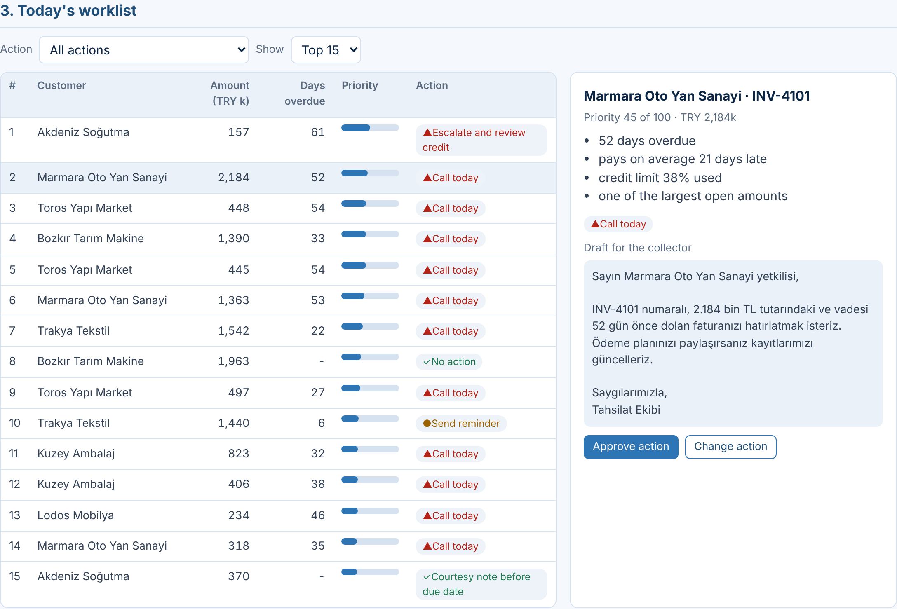
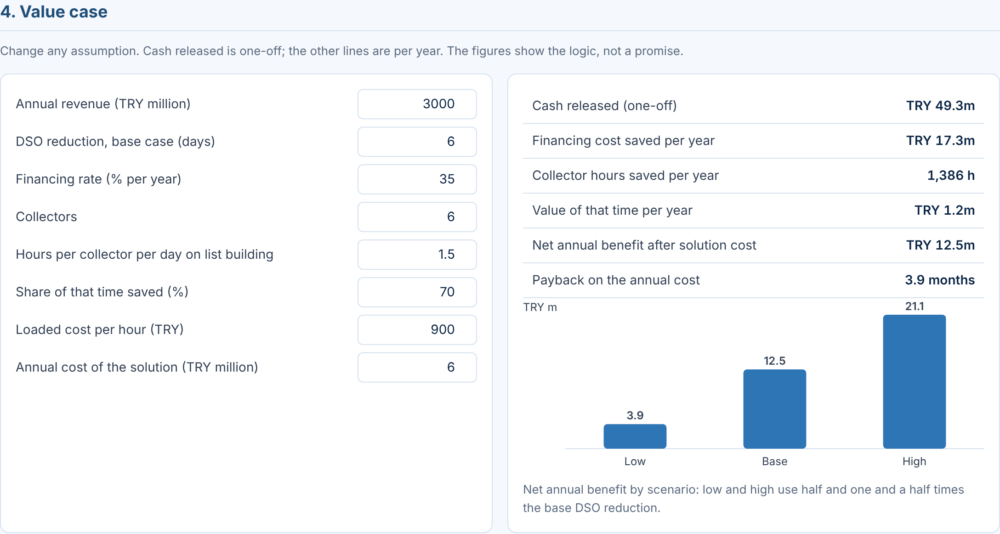

# Receivables agent

### Which invoices should your collections team chase today, and why?

**[Open the live demo](https://htmlpreview.github.io/?https://github.com/alihanarica/alihanarica/blob/main/demos/ai-receivables-agent/index.html)** &nbsp;·&nbsp; [View the code](index.html)

Most collections teams build their daily call list by amount. Large customers who always pay get the calls. Smaller customers whose payment habits are getting worse slip through, until the debt is 90 days old.

This agent changes the question from "who owes the most?" to "where is the risk today?"

- **It ranks every open invoice** from five factors: days overdue, the customer's payment history, amount, credit limit use and open disputes.
- **It explains every priority** in plain words, so a collector can trust it or overrule it.
- **It proposes the next action** and drafts the reminder in Turkish.
- **A person approves every action.** Nothing goes to a customer without a collector's decision.

## What it is worth

For a sample manufacturer with TRY 3 billion revenue, cutting days sales outstanding by 6 days releases about **TRY 49 million in cash**. With the financing and time savings, net benefit is about **TRY 12.5 million a year**, and the solution pays back in **about 4 months**.

Every assumption is editable on the page. The point is not the number. It is to give the customer's finance team a model they can challenge and own.

## How a pilot proves it

Success is agreed before the pilot starts, not after:

| Measure | Target to go ahead |
|---|---|
| Overdue value above 30 days, against a control group | At least 10% lower |
| Top 20 priority items contacted within 48 hours | 90% or more |
| Collector time spent building the list | Down by half |
| Proposed actions the collectors accept | 70% or more |
| Actions sent without approval | Zero |

I used this method in AI sales: when customer, seller and partner agree acceptance and ROI criteria at the start, proofs of concept ran about 30 to 40 percent shorter.

## How it would run on SAP

| In the prototype | In a real project |
|---|---|
| Open invoices, due dates, amounts | Open items in SAP S/4HANA Accounts Receivable |
| Average days late | Payment history of cleared items |
| Credit limit use | SAP Credit Management |
| Open disputes | SAP Dispute Management |
| Worklist and approval | An agent built in Joule Studio, with the collector approving each action |

## Notes

- This is a field prototype for a first customer conversation. It is not an SAP product and is not connected to any system.
- The company, customers and figures are invented.
- SAP offers its own Joule agents for receivables. A prototype like this lets a customer see the value in their own terms before a pilot of the real product.
- One HTML file, no dependencies, no API key. Open `index.html` in any browser; no data leaves the page.

Built with AI coding tools by [Alihan Arıca](https://www.linkedin.com/in/alihanarica), November 2026.
